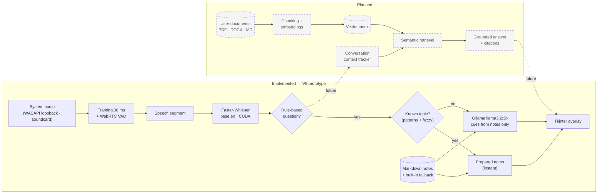

# Baya.io

**Real-Time Context-Aware AI Copilot**

🚧 **Work in Progress — Active Development**

Baya.io is an experimental desktop assistant. Its goal is to surface relevant, source-grounded information during live conversations without interrupting the user. It began as a local AI interview-practice tool that combined real-time speech recognition with a local language model. It is now evolving into a document-grounded knowledge copilot for technical, legal, academic and business meetings.

The pufferfish (*baiacu*) is the project's mascot and visual identity.


*Concept preview illustrating the intended Baya.io experience. The interface and document-grounded assistance shown are under development and are not yet implemented in the current prototype.*

> **Important:** The image above is a design mockup of the target product. The current prototype is a Tkinter window that shows speaking cues for interview practice. It does not ingest PDF or DOCX documents, perform retrieval-augmented generation, or produce legal citations. See [Current Development Status](#current-development-status).

---

## Table of Contents

- [Project Overview](#project-overview)
- [Motivation](#motivation)
- [Current Development Status](#current-development-status)
- [How the Current Prototype Works](#how-the-current-prototype-works)
- [Long-Term Product Vision](#long-term-product-vision)
- [Technology Stack](#technology-stack)
- [Research Direction](#research-direction)
- [Development Roadmap](#development-roadmap)
- [Repository Structure](#repository-structure)
- [Installation](#installation)
- [Limitations](#limitations)
- [Privacy and Responsible Use](#privacy-and-responsible-use)
- [Contributing](#contributing)
- [License](#license)

---

## Project Overview

Professionals in technical reviews, legal consultations, academic discussions and business meetings often need precise facts from long documents, and they need them *while the conversation is happening*. Searching manually breaks focus and slows the discussion.

Baya.io aims to close that gap. The intended copilot listens to an authorized meeting, detects when a question is asked, and retrieves supporting evidence from documents the user has provided. It then shows a short answer with a reference to the original source, so the user can respond accurately without leaving the conversation.

## Motivation

The project started as a personal experiment: could a fully local pipeline capture live audio, transcribe it, recognize a question and show helpful cues fast enough to be useful during a real conversation? Everything ran on a consumer GPU, with no cloud services.

The first use case was **English interview practice**. Four recovered iterations (V4 → V8) explored:

- low-latency audio segmentation and transcription
- free-form LLM answer generation, which was later abandoned because it tended to produce unsupported claims
- a stricter approach in which the assistant only shows **cues taken from the user's own prepared notes**, and the local LLM is used only to map unexpected questions back to those notes

That final design choice, *grounding output in user-provided material instead of letting the model invent content*, is the foundation for the broader goal: a general-purpose, document-aware meeting copilot.

## Current Development Status

Every item marked as implemented below was verified by reading the source code of the V8 prototype ([`src/baya_v8.py`](src/baya_v8.py)). None of it has been benchmarked yet.

> **Public edition:** the personal interview notes of the original prototype were replaced by notes for a **fictitious legal demo case** (*Ana Ribeiro v. Horizonte Logística Ltda.*, a civil liability claim after a traffic accident). All names, dates and amounts are invented. The pipeline itself is unchanged.

### ✅ Implemented (verified in source code)

| Area | What exists today |
|---|---|
| Audio capture | System-audio capture via **WASAPI loopback** (`soundcard`) from the default Windows output device, at 16 kHz mono. Reads in 300 ms blocks split into 30 ms frames. |
| Voice activity detection | **WebRTC VAD** (aggressiveness 2) with an RMS energy gate, 300 ms pre-roll, 750 ms end-of-speech silence, 300 ms minimum speech and an 18 s maximum segment. |
| Speech recognition | **Faster-Whisper** `base.en` on CUDA (float16), English only, beam size 2, with hallucination-silence and no-speech thresholds. |
| Question detection | Rule-based heuristics: question mark, interrogative openings and common conversational phrasings. |
| Topic matching | 17 predefined topics of the demo case (parties, facts, legal basis, damages, evidence, etc.) matched by substring patterns, with a `difflib` fuzzy fallback (similarity ≥ 0.79). |
| Notes loading | Optional `notes.md` file next to the script. Reads table cells under `##`–`####` headings and falls back to the built-in demo notes. |
| Grounded cue display | Known topics show the user's prepared notes **instantly**, with no LLM call. |
| Local LLM fallback | Unmatched questions go to **Ollama** (`llama3.2:3b`, temperature 0). The prompt asks for 3–5 short cues taken *only* from the notes, or the reply "No prepared notes for this question." |
| Concurrency | Four worker threads (capture → VAD → transcription → generation) connected by bounded queues with a drop-oldest policy. |
| Desktop interface | **Tkinter** always-on-top window with Start/Stop, a status line, the detected question, the cues and per-question latency readouts. |

### 🔧 Under development

- Moving the demo notes out of the source code into an example notes file
- Pinning reproducible dependency versions
- Splitting the single-file prototype into modules (audio, ASR, detection, generation, UI)

### 🗺️ Planned (not implemented)

- PDF, DOCX and general Markdown document ingestion
- Document chunking, embeddings and semantic retrieval (RAG)
- Source citations that link each suggestion back to its document
- Conversation context tracking across multiple turns
- Domain-agnostic question detection (beyond interview phrasings)
- Multilingual transcription (including Portuguese)
- Redesigned floating assistant UI, project-specific document libraries and Windows packaging
- Formal evaluation: retrieval accuracy, latency and citation reliability

## How the Current Prototype Works



Solid boxes exist in the code today. Dashed boxes are planned. See [`docs/architecture.md`](docs/architecture.md) for a component-level description and the version history.

## Long-Term Product Vision

Baya.io is intended to:

1. Listen to **authorized** live meetings.
2. Let users upload PDF, DOCX and Markdown documents.
3. Retrieve relevant information using Retrieval-Augmented Generation (RAG).
4. Display concise, evidence-grounded information.
5. Provide references to the original documents.
6. Support technical, legal, academic and business discussions.
7. Prioritize low latency, privacy and factual reliability.

*These are planned capabilities. Most of them are not implemented yet.*

## Technology Stack

### In use (verified)

| Component | Technology |
|---|---|
| Language | Python (developed on Python 3.12, Windows) |
| Audio capture | [`soundcard`](https://github.com/bastibe/SoundCard) (WASAPI loopback) |
| Voice activity detection | [`webrtcvad`](https://github.com/wiseman/py-webrtcvad) |
| Speech recognition | [`faster-whisper`](https://github.com/SYSTRAN/faster-whisper) (`base.en`, CUDA float16) |
| Local LLM | [Ollama](https://ollama.com) HTTP API with `llama3.2:3b` |
| HTTP client | `requests` |
| Numerical processing | `numpy` |
| Desktop UI | `tkinter` |
| Hardware used during development | NVIDIA RTX 4060, CUDA 12.9, cuDNN 9 |

### Under consideration (not yet adopted)

- Document parsing: e.g. `pypdf` / PyMuPDF, `python-docx`
- Embeddings: sentence-transformer models or Ollama embedding models
- Vector search: FAISS, Chroma or a similar local index
- Evaluation: retrieval metrics (Recall@k, MRR), latency profiling, citation-faithfulness checks
- Packaging: PyInstaller or a comparable Windows installer

## Research Direction

**Research question:**

> *How can real-time retrieval-augmented generation provide accurate, source-grounded information during live conversations while minimizing response latency?*

Areas of interest:

- **Information Retrieval:** chunking and retrieval strategies for spoken, partial and noisy queries
- **Natural Language Processing:** question detection and intent recognition from live transcripts
- **Retrieval-Augmented Generation:** grounding generated text strictly in retrieved evidence
- **Trustworthy AI:** making system behaviour transparent and verifiable for the user
- **Citation reliability:** checking that each displayed statement is supported by the cited source
- **Hallucination reduction:** abstaining when evidence is missing, as V8 already does at a basic level
- **Low-latency inference:** end-to-end latency budgets on local hardware, and local versus cloud trade-offs

No experiments, benchmarks or scientific results have been produced yet. The prototype shows per-question timing in its interface, but those readings have not been collected, controlled or analysed. See [`docs/roadmap.md`](docs/roadmap.md).

## Development Roadmap

| Phase | Item | Status |
|---|---|---|
| **1 — Initial Prototype** | Local audio capture | ✅ Implemented (system-audio loopback only) |
| | Speech recognition | ✅ Implemented (English, GPU required) |
| | Local LLM integration | ✅ Implemented (Ollama, fallback path) |
| | Basic desktop interface | ✅ Implemented (Tkinter) |
| **2 — Document Intelligence** | Document ingestion | 🟡 Precursor only: one Markdown notes file (tables) |
| | Semantic search | ⬜ Planned |
| | RAG | ⬜ Planned |
| | Source citations | ⬜ Planned |
| **3 — Context-Aware Assistance** | Context tracking | ⬜ Planned |
| | Question detection | 🟡 Rule-based, interview-specific |
| | Evidence-grounded information | 🟡 Notes-only cues; no document evidence yet |
| | Retrieval optimization | ⬜ Planned |
| **4 — Desktop Experience** | Improved interface | ⬜ Planned |
| | Document libraries | ⬜ Planned |
| | Floating assistant | 🟡 Always-on-top window exists; redesign planned |
| | Windows packaging | ⬜ Planned |
| **5 — Research and Evaluation** | Retrieval accuracy benchmarks | ⬜ Planned |
| | Latency measurements | 🟡 Timing shown in UI; no systematic measurement |
| | Citation reliability evaluation | ⬜ Planned |
| | Reproducible experiments | ⬜ Planned |

Details: [`docs/roadmap.md`](docs/roadmap.md) · Issue plan: [`docs/issue-plan.md`](docs/issue-plan.md)

## Repository Structure

```
baya-io/
├── README.md
├── .gitignore
├── requirements.txt
├── assets/
│   └── baya-concept.png          # Concept mockup (not a screenshot)
├── src/
│   └── baya_v8.py                # Current prototype (V8, public edition)
└── docs/
    ├── architecture.md
    ├── roadmap.md
    └── issue-plan.md
```

## Installation

> These steps reflect what the current code requires. They target **Windows** with an **NVIDIA GPU**. The prototype has no CPU fallback and uses Windows-specific audio loopback.

**Prerequisites**

- Windows 10/11
- Python 3.12 (with `tkinter`, included in the standard installer)
- NVIDIA GPU with CUDA 12 and cuDNN 9 installed. The script adds these folders to the DLL search path if they exist:
  - `C:\Program Files\NVIDIA GPU Computing Toolkit\CUDA\v12.9\bin`
  - `C:\Program Files\NVIDIA\CUDNN\v9.28\bin\12.9\x64`
- [Ollama](https://ollama.com) running locally on the default port (`127.0.0.1:11434`)

**Steps**

```powershell
git clone https://github.com/<your-username>/baya-io.git
cd baya-io
python -m venv .venv
.venv\Scripts\activate
pip install -r requirements.txt
ollama pull llama3.2:3b
python src\baya_v8.py
```

Click **Start listening**. The Whisper model is downloaded on first use.

Try asking aloud (or playing audio of) questions such as *"What must be proven for the defendant to be held responsible?"* or *"Which court should we file in?"*.

**Optional:** place your own Markdown notes in `src/notes.md` (`##` headings plus tables). Without it, the built-in demo notes are used. This file is git-ignored on purpose.

> `webrtcvad` is compiled from source on some setups and may need the Microsoft C++ Build Tools.

## Limitations

- **Experimental and not production-ready.** The code is a single-file research prototype.
- Transcription errors are expected, especially with accents, overlapping speakers, background noise or domain-specific vocabulary.
- English only (`base.en`).
- Captures **all** system output audio and does not separate speakers.
- Question detection and topic matching are rule-based and tuned to a fixed set of phrasings. They miss questions and misfire on non-questions.
- The local LLM can still produce inaccurate cues despite the restrictive prompt.
- No document retrieval, RAG or citations yet.
- Requires an NVIDIA GPU and hardcoded CUDA/cuDNN paths. Not tested on other hardware or operating systems.
- No automated tests yet.
- Latency figures shown in the UI are informal readings, not benchmarks.

## Privacy and Responsible Use

- **Only capture audio from conversations you are authorized to record or process, with the knowledge and consent of the other participants.** Recording and consent laws vary by jurisdiction. Users are responsible for complying with them.
- All processing in the current prototype runs **locally**: transcription on the local GPU and the LLM through a local Ollama server. The code does not send audio or transcripts to external services and does not save recordings to disk.
- Baya.io does **not** currently provide encryption, access control, audit logging, or any enterprise-grade security or regulatory compliance guarantees.
- Never commit personal notes, private documents, client or legal materials, recordings or credentials to this repository.
- The original interview use case was **practice**. Using AI assistance covertly in real interviews or assessments may break the rules of the process and is not an intended use.

## Contributing

The architecture is still changing rapidly, so large pull requests may be hard to merge right now. Issues, ideas, bug reports and discussion are welcome, especially on retrieval strategies, low-latency ASR and evaluation methodology. Please open an issue before starting significant work.

## License

No license has been selected yet. Until one is added, all rights are reserved by the author.
