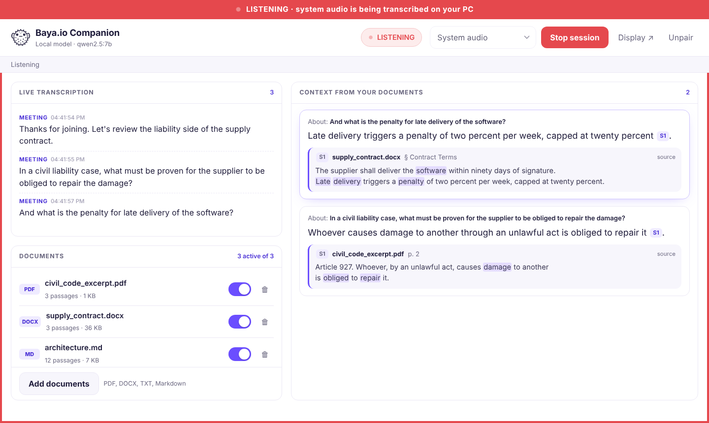
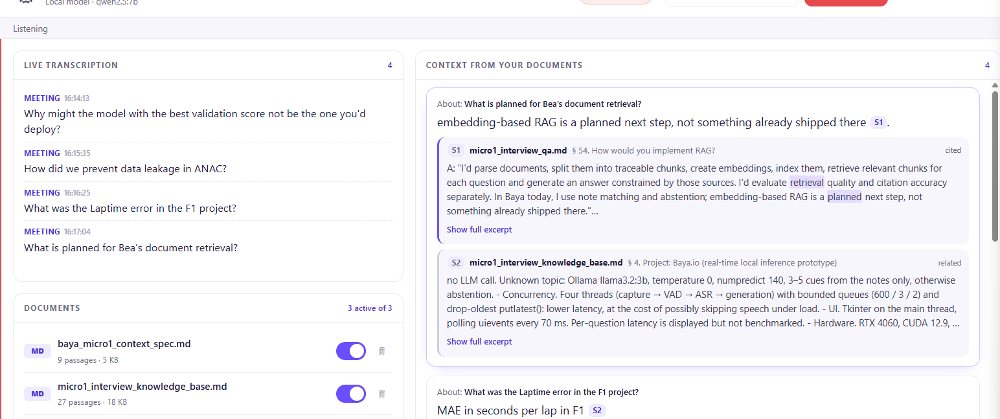
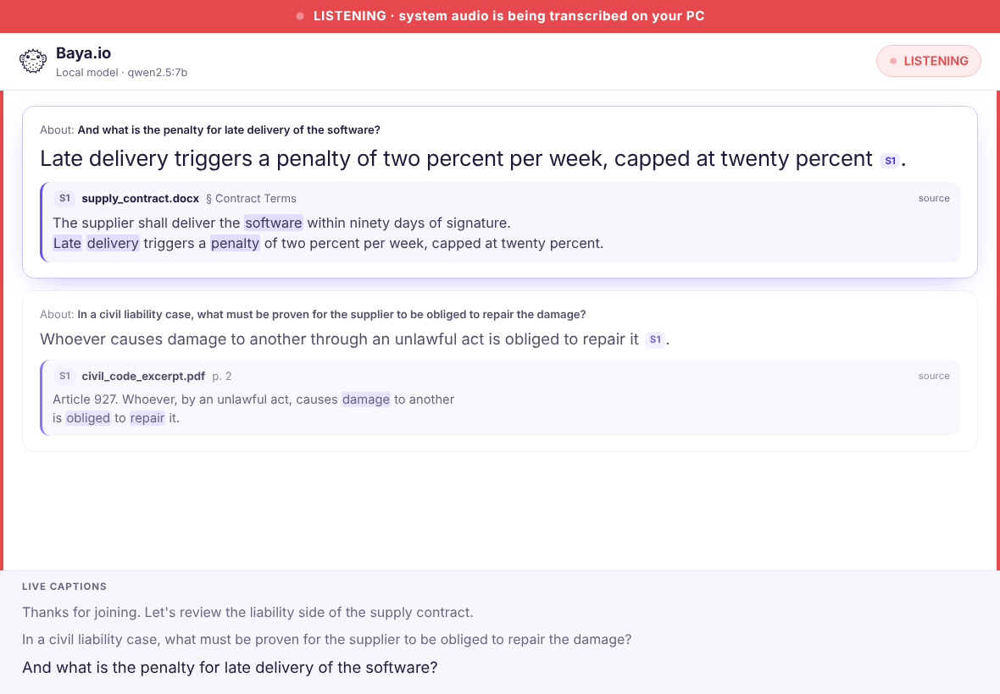
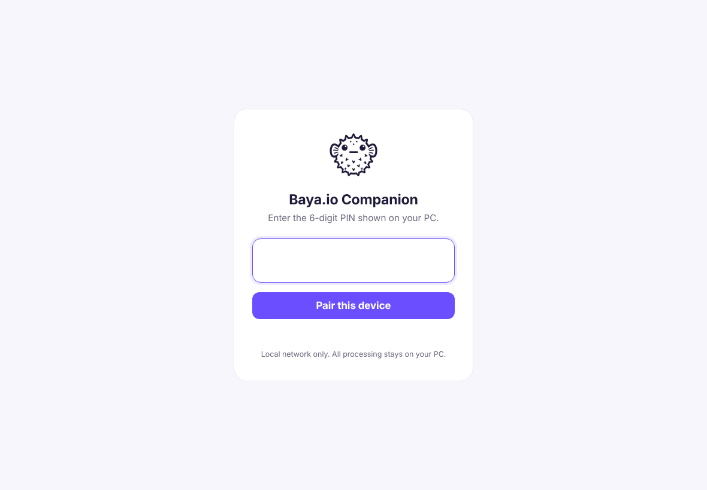
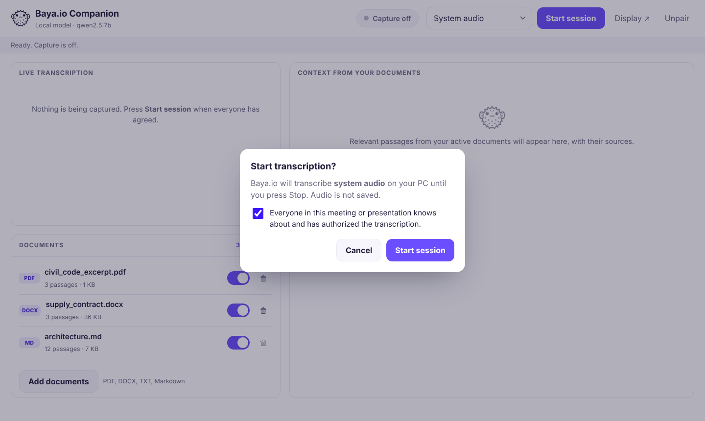
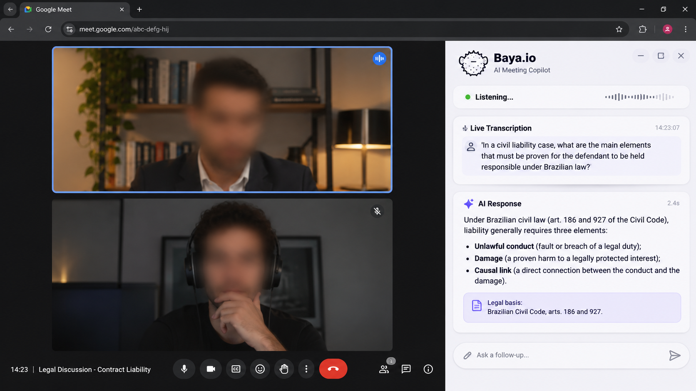
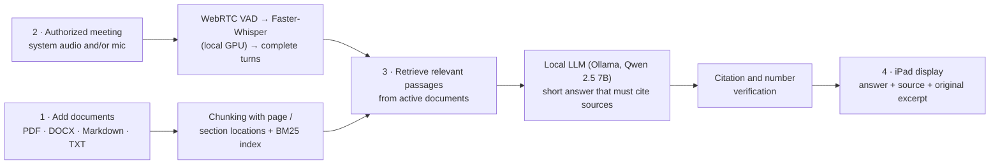

# Baya.io

**Real-Time Context-Aware AI Copilot**

✅ **MVP complete. Functional end to end, with accuracy work ongoing.**

Baya.io is a local AI copilot that follows a live, authorized conversation, works out what is being discussed, and shows relevant passages from **your own documents** at the right moment, with the source and the original excerpt.

It is not meant to be just a meeting transcriber or another chatbot. The aim is an assistant that understands the topic of the conversation and anticipates which parts of your material may be useful.

The pufferfish (*baiacu*) is the project's mascot and visual identity.



*PC control panel during a demo session with sample documents: live transcription on the left, answers grounded in the documents on the right.*

---

## Table of Contents

- [How Baya.io is meant to be used](#how-baya-io-is-meant-to-be-used)
- [Screenshots](#screenshots)
- [How it works](#how-it-works)
- [What makes it different](#what-makes-it-different)
- [Current status](#current-status)
- [Technology stack](#technology-stack)
- [Installation and usage](#installation-and-usage)
- [Engineering skills demonstrated](#engineering-skills-demonstrated)
- [Research direction](#research-direction)
- [Limitations](#limitations)
- [Privacy and responsible use](#privacy-and-responsible-use)
- [Repository structure](#repository-structure)
- [Project history](#project-history)
- [License](#license)

---

## How Baya.io is meant to be used

| Scenario | What Baya.io does |
|---|---|
| **Professional meetings** | During an authorized call (Google Meet, Zoom, Teams), it follows the topics being discussed and shows relevant data, arguments and references from your documents. |
| **Legal meetings** | You add contracts, legislation and legal opinions. When someone mentions a clause or a legal question, Baya.io finds the related passages. |
| **Technical discussions** | You load Python or ML documentation and reports from your projects. Baya.io retrieves explanations, metrics and technical decisions during the conversation. |
| **Second screen on an iPad** | The PC processes the audio and searches the documents. The iPad only displays the results, so the presentation screen stays clean. |

## Screenshots

### Real session: the author's project notes (Windows · RTX 4060 · Qwen 2.5 7B)



*A question asked aloud is transcribed, matched to the author's own notes, and answered in one sentence with its source (`S1`). The original excerpt stays visible so the answer can be checked.*

### iPad results display



*The iPad shows only results: the latest answer in large type, older ones dimmed, live captions at the bottom, and a red LISTENING banner while capture is on.*

| Pairing the iPad with a PIN | Consent before every session |
|---|---|
|  |  |

*The demo screenshots use sample documents (a civil code excerpt and a fictitious supply contract) and a scripted conversation.*

### Product vision (concept, not the current UI)



*Concept preview of the long-term product experience. It is a design mockup, not a screenshot.*

## How it works



1. **You add your documents.** PDF, DOCX, Markdown and TXT files are split into passages that keep their page, section or line location.
2. **Baya.io follows the authorized meeting.** It captures system audio, the microphone or both, detects speech, transcribes it on the GPU, and merges segments into complete turns. Introductions are skipped so the search focuses on the actual question.
3. **It retrieves relevant knowledge.** BM25 search over the *active* documents, with section headings weighted. If a question has nothing in the documents, Baya.io says so instead of guessing.
4. **It shows the information on the iPad.** A short answer from the local model that must cite the numbered source, plus the original excerpt. Citations to sources that do not exist are removed, and numbers that do not appear in the excerpt are flagged.

## What makes it different

**The knowledge is temporary and under your control.** Tomorrow you have a meeting about a Machine Learning project: you add the documentation and reports, Baya.io uses them as context, and afterwards you deactivate or delete them.

- Deleting a document removes the file, its passages, the search index entries and cached results, and every answer in the current session that cited it, including an answer still being generated.
- The language model is **never trained** on your files. They are only passed as context for one answer at a time, so removing them from the library removes them from everything Baya.io can consult.
- Everything runs **locally**: audio, transcripts and documents never leave the PC.

## Current status

### ✅ Implemented and working

| Area | What exists |
|---|---|
| Audio capture | System audio (WASAPI loopback), microphone, or both. Capture is off until Start is pressed. |
| Speech recognition | WebRTC VAD + Faster-Whisper `base.en` on CUDA, with segments merged into complete turns. |
| Document library | PDF, DOCX, TXT and Markdown, with activate / deactivate / delete and duplicate detection. Unreadable files (scanned, encrypted, corrupted) get clear errors. |
| Retrieval | BM25 with section headings weighted and short-question handling. |
| Grounded answers | Qwen 2.5 7B via Ollama, streamed, with one cited source per answer and the original excerpt. |
| Verification | Invalid citations removed and unsupported numbers flagged. |
| Second screen | FastAPI server on the local network. The PC gets a control panel, the iPad a results-only display (Safari, live updates over SSE). |
| Security | PIN pairing, HttpOnly session cookies, rate limiting, local-network-only access, cross-site request blocking, CSP. |
| Tests | 96 automated tests (pytest) with real PDF, DOCX, TXT and Markdown files and problem cases. |

### 🔧 Ongoing improvements

- **Retrieval accuracy:** hybrid search (BM25 + local embeddings) for questions phrased differently from the documents.
- **Context detection:** better identification of what is being asked when a turn mixes comments and questions.
- **Answer quality:** evaluation of citation faithfulness and answer usefulness on a fixed question set.

### 🗺️ Next

- Multilingual transcription (Portuguese).
- HTTPS for the local network.
- Windows packaging.
- Reproducible benchmarks of retrieval accuracy and latency.

## Technology stack

| Layer | Technology |
|---|---|
| Language | Python 3.12 (Windows) |
| Audio | `soundcard` (WASAPI loopback and microphone), `webrtcvad` |
| Speech recognition | `faster-whisper` (`base.en`, CUDA float16) |
| Language model | Ollama: `qwen2.5:7b` (default), `llama3.2:3b` |
| Documents | `pypdf`, `python-docx` |
| Retrieval | BM25 implemented in Python (no external database) |
| Server | FastAPI, Uvicorn, Server-Sent Events |
| Interface | HTML, CSS and plain JavaScript (no framework) for the PC and the iPad; Tkinter status window |
| Tests | pytest, httpx |
| Hardware used | NVIDIA RTX 4060, CUDA 12.9, cuDNN 9 |

## Installation and usage

**Requirements:** Windows 10/11, Python 3.12, an NVIDIA GPU with CUDA 12 and cuDNN 9, and [Ollama](https://ollama.com).

```powershell
git clone https://github.com/CaioBandeira7/baya-io.git
cd baya-io
python -m venv .venv
.venv\Scripts\activate
pip install -r requirements.txt -r requirements-companion.txt
ollama pull qwen2.5:7b
start_companion.bat
```

1. The **control panel** opens in the PC's browser automatically. Add documents and choose the audio source.
2. On the **iPad** (same Wi-Fi), open the address shown in the PC status window in Safari, typing `http://` explicitly, and enter the 6-digit PIN.
3. Press **Start session** on the PC and confirm that everyone has authorized the transcription.

Details, options and security notes: [`docs/companion.md`](docs/companion.md). Run the tests with `python -m pytest tests -q`.

## Engineering skills demonstrated

- Local GPU inference (Faster-Whisper, Ollama).
- Real-time speech recognition with voice activity detection.
- Concurrent processing with bounded queues and latency control.
- Information retrieval over documents (chunking, BM25, source locations).
- Grounded answer generation with citation and number verification.
- Integration of Python, a local HTTP API, live events and web interfaces.
- Security for local-network services (pairing, sessions, rate limiting, CSRF, CSP).
- Automated testing with real files and edge cases.

## Research direction

> *How can real-time retrieval-augmented generation provide accurate, source-grounded information during live conversations while minimizing response latency?*

Topics of interest: information retrieval for spoken and noisy queries, question detection from live transcripts, grounding generated text in retrieved evidence, citation reliability, hallucination reduction, and low-latency local inference.

The components above make it possible to run experiments on speed, retrieval precision and answer reliability. **No benchmarks have been published yet**; the planned methodology is in [`docs/roadmap.md`](docs/roadmap.md).

## Limitations

- Retrieval is keyword-based (BM25): a question phrased with different words from the document may be missed or matched to a less relevant passage.
- Transcription is English-only and requires an NVIDIA GPU.
- The local model can still produce imperfect summaries; the original excerpt is always shown so the answer can be checked.
- Local traffic is plain HTTP; use it only on a trusted home or office network.
- No OCR: scanned PDFs are rejected.

## Privacy and responsible use

- **Only transcribe conversations you are authorized to process, with the knowledge and consent of the participants.** Recording and consent rules vary by jurisdiction.
- Baya.io shows a red **LISTENING** banner on the iPad and a status window on the PC whenever capture is on. It has no hidden mode.
- Audio is never written to disk. Transcripts and answers live in memory and are cleared when the session stops.
- Baya.io is not intended to give covert assistance in interviews, exams or any assessment where outside help is not allowed.
- It provides no enterprise security or regulatory compliance guarantees.

## Repository structure

```
baya-io/
├── companion/              # Baya.io Companion: audio pipeline, library, assistant, FastAPI server
│   └── static/             # PC control panel, iPad display, pairing page, pufferfish logo
├── tests/                  # pytest suite (96 tests)
├── src/baya_v8.py          # Original real-time prototype (V8, Tkinter)
├── docs/                   # companion.md, architecture.md, roadmap.md, issue-plan.md
├── assets/                 # Screenshots and concept image
├── start_companion.bat
├── requirements.txt
└── requirements-companion.txt
```

## Project history

Baya.io started as a local interview-practice assistant (V4–V8): live audio, Faster-Whisper, a local LLM and a Tkinter overlay. The key lesson from those versions was that free-form generation produced unsupported claims, while **grounding every answer in the user's own material** made the output reliable. The Companion turns that lesson into a general, document-grounded meeting copilot with a second screen. See [`docs/architecture.md`](docs/architecture.md).

## License

No license has been selected yet. Until one is added, all rights are reserved by the author.
