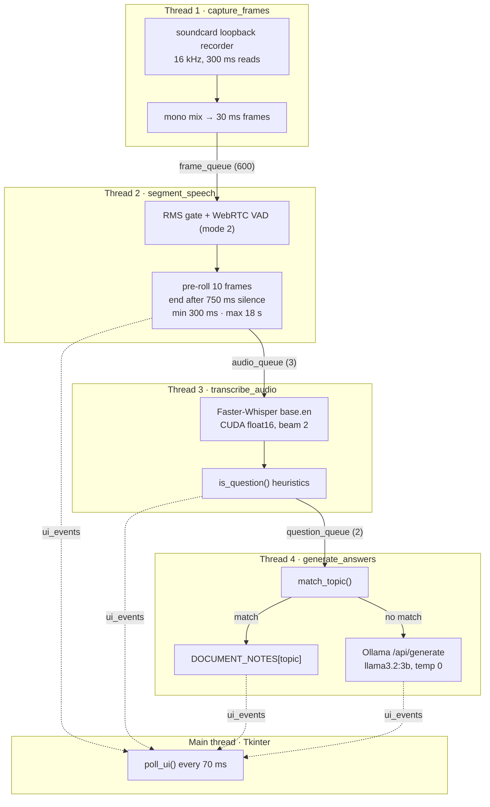
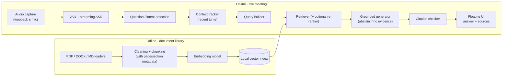

# Architecture

> Status: 🚧 Work in Progress. This document describes the **current V8 prototype** as verified in the source code, followed by the **target architecture** that is planned but not implemented.

## 1. Current prototype (V8)

File: [`src/baya_v8.py`](../src/baya_v8.py). It is a single module of about 480 lines.

In this public edition, the original personal interview notes were replaced by notes for a fictitious legal demo case, and personal names were removed from UI labels and the prompt. The pipeline logic is unchanged.

### 1.1 Pipeline

All queues are bounded. `put_latest()` drops the oldest item when a queue is full. This keeps latency low at the cost of possibly skipping speech under load.

### 1.2 Components

| Component | Function(s) | Notes |
|---|---|---|
| CUDA bootstrap | module top-level | Adds hardcoded CUDA 12.9 / cuDNN 9 paths to `PATH` and the DLL search path if they exist. |
| Audio capture | `capture_frames` | `sc.get_microphone(id=default_speaker.id, include_loopback=True)` captures **system output**, not the microphone. |
| Segmentation | `segment_speech` | Energy threshold `MIN_RMS = 0.001` plus WebRTC VAD. Each segment is timestamped at its end for latency measurement. |
| ASR | `transcribe_audio` | `language="en"`, `vad_filter=False` (external VAD is used), `condition_on_previous_text=False`. |
| Question detection | `is_question` | Skips utterances under 3 words and courtesy phrases. Accepts text with `?`, interrogative openings or interview phrasings. |
| Topic matching | `match_topic`, `normalized` | Longest substring pattern wins. Otherwise a `difflib.SequenceMatcher` ratio of at least 0.79 is required. |
| Knowledge source | `load_document_notes`, `FALLBACK_NOTES` | Splits `notes.md` on `##`–`####` headings, maps each heading to a topic and keeps up to 8 table cells. Uses the built-in demo notes when the file is missing. |
| Generation | `make_bullet_prompt`, `generate_answers` | Known topic: notes shown directly (0 s LLM time). Unknown topic: the LLM is asked for 3–5 cues of 3–10 words each, *only from notes*, or an explicit abstention. |
| UI | Tkinter section | Always-on-top window. Start/Stop, status, device, question, cues, latency metrics. Updates only on the main thread through `ui_events`. |

### 1.3 Grounding behaviour

V8 already applies a simple form of the project's core principle: **prefer user-provided material over model knowledge**.

1. If the question matches a known topic, the system shows the user's own notes and never calls the LLM.
2. Otherwise, the LLM only *interprets* the question against the notes. The prompt forbids invented facts and requires the fixed abstention string when the notes do not cover the question.
3. If the model's output contains no bullet lines, the abstention string is shown.

This is **topic lookup, not retrieval**. There are no embeddings, no ranking over passages and no citations.

### 1.4 Known code-level observations

These are recorded for future cleanup. They have **not** been changed, so that the prototype's behaviour is preserved.

- `classify_question` and `format_spoken_answer` are defined but never called in V8. They are left over from V5/V6.
- `warnings`, `textwrap` and `ttk` are imported but unused.
- The model and device are fixed (`device="cuda"`) and there is no CPU fallback.
- Demo notes are hardcoded in `FALLBACK_NOTES` rather than loaded from an example file.
- Configuration is set through module constants. There is no config file or CLI.

## 2. Version history (recovered)

| Version | File | Interface | Answer strategy | Main change |
|---|---|---|---|---|
| V4 | not published | Console | Free-form LLM answer (≤ 45 words) from a short profile | First end-to-end pipeline with timing breakdown |
| V5 | not published | Console | Free-form LLM answer with 11 intent categories | Larger capture blocks (300 ms), overflow warnings, expanded profile |
| V6 | not published | Tkinter | Same as V5 | First desktop overlay with event-queue UI updates |
| V7 | — | — | — | Not recovered |
| **V8** | `src/baya_v8.py` | Tkinter | **Speaking cues from the user's notes; LLM only as constrained fallback** | Shift from generation to grounding |

Earlier versions are kept privately because they embed personal profile data.

The move from V6 to V8 is the conceptual turning point. Free-form generation was replaced by retrieval from user-owned content, with explicit abstention when that content is missing.

## 3. Target architecture (planned, not implemented)

Design principles for the target system:

- **Evidence first:** every displayed statement should be traceable to a retrieved passage.
- **Abstain over guess:** when retrieval confidence is low, show nothing or say so.
- **Latency budget:** each stage (ASR, retrieval, generation) is instrumented so trade-offs can be measured.
- **Local by default:** cloud inference only as an explicit, opt-in option.
